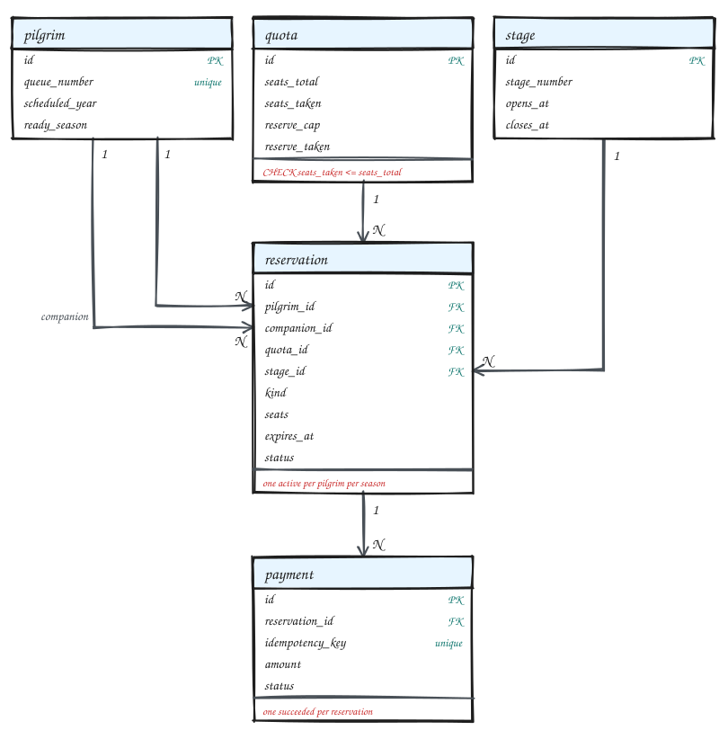
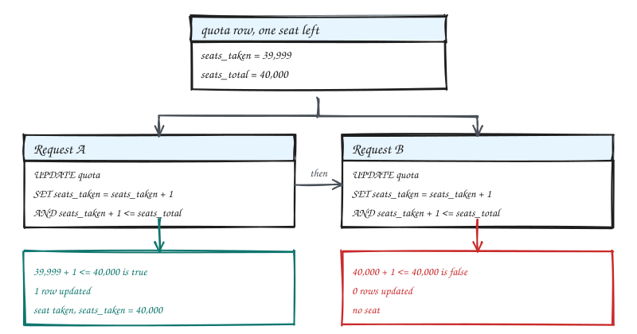
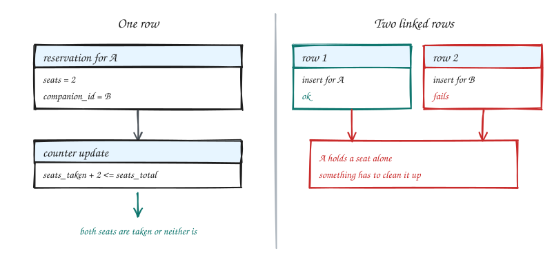
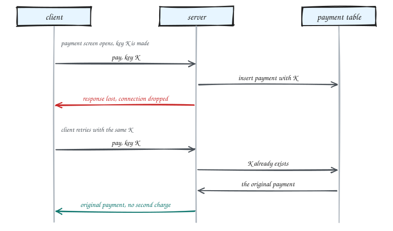

[Part 4](/blog/hajj-ticket-war-part-4#the-number-that-limits-the-design) ended on one counter per province, so the data model starts there. There are five entities: pilgrim, quota, stage, reservation, and payment.

The tables exist to enforce the two rules from [part 3](/blog/hajj-ticket-war-part-3#what-it-must-never-do). Never give out more seats than the quota and never take money for a seat that can't be given.

I'm writing it as tables with constraints, because a constraint in the database still holds when the application code has a bug. Which database to use comes with the high-level design.

Every `id` is a UUID v7. Many servers create rows at the same time, and each of them can make an id without asking the database. A v7 starts with a timestamp, so new rows land at the end of the index the way a counter would, which random UUIDs don't do.



The diagram shows the relations and the key columns. The tables below have the rest.

## Pilgrim

A pilgrim is a person in the queue, or a newcomer who has an account but has not registered yet.

| Column | Type | Notes |
|---|---|---|
| `id` | uuid | primary key |
| `queue_number` | bigint | unique, can be empty |
| `province_id` | int | |
| `scheduled_year` | int | |
| `birth_date` | date | |
| `deferred` | boolean | paid in full but postponed |
| `health_check_valid_until` | date | can be empty |
| `ready_season` | int | can be empty |

Which stage a pilgrim belongs to is not a column. The system calculates it every time it checks a pilgrim, from `scheduled_year` and the current season. The elderly are found from `birth_date`.

Take someone scheduled for 2031. Stage 2 is for people scheduled within the next 4 years, so in 2026 they're in stage 3 and in 2027 they're in stage 2, and nothing about them changed. If the stage were stored, it would be wrong every season for everyone whose window moved, and fixing it means rewriting millions of rows each year.

`ready_season` holds the season someone got ready for. Say someone gets ready for 2027, so `ready_season` is 2027.

The system only counts them as ready when `ready_season` equals the current season. In 2028 the old value no longer matches, so they only count as ready again if they get ready for 2028.

A yes or no flag would stay true after the season ends, so a job would have to reset it for millions of people every year. Storing the season needs no job.

Marking someone ready is only accepted while the health check is still valid.

`queue_number` is unique and can be empty. A newcomer in stage 4 creates an account before registering, so they have no number yet and get one when they register. That's why the table has its own `id`.

## Quota and the seat counter

Quota is one row per province per season.

| Column | Type | Notes |
|---|---|---|
| `id` | uuid | primary key |
| `province_id` | int | unique with `season` |
| `season` | int | |
| `seats_total` | int | |
| `seats_taken` | int | `CHECK (seats_taken <= seats_total)` |
| `reserve_cap` | int | |
| `reserve_taken` | int | `CHECK (reserve_taken <= reserve_cap)` |
| `deferred_count` | int | |

`seats_total` is the quota after stage 0 comes off. In the East Java example from [part 1](/blog/hajj-ticket-war-part-1#rules-per-stage), that's 42,409 minus 2409, so 40k seats.

Taking a seat is one conditional update, not a read followed by a write:

```sql
-- $1 is the number of seats, $2 is the quota id
UPDATE quota
SET seats_taken = seats_taken + $1
WHERE id = $2
  AND seats_taken + $1 <= seats_total;
```

If no row is updated, there was no seat. The condition and the update are one statement, so the database checks the number and changes it in one step.

Two requests can't both see one seat left and both take it. Postgres locks the row while one update runs. The second update waits, then checks the condition against the new number, so it finds no seat.

A `CHECK (seats_taken <= seats_total)` sits behind it. If some other code updates `seats_taken` and forgets the condition, the database rejects the write instead of overselling.



`seats_taken` should always equal the `seats` added up across the reservations that hold seats for that quota. A background check compares the two in case a bug makes them differ.

## The overbooking cap

`reserve_cap` is the small overbooking limit, 0.5% of the province quota. On the 40k seats above, that's 200 reserves.

A reserve reservation holds no seat. It counts against `reserve_taken` with the same kind of conditional update, so overbooking can never grow past the cap, and it can never push `seats_taken` over `seats_total`.

[Part 3](/blog/hajj-ticket-war-part-3#what-the-system-has-to-do) says a reserve has to know they're a reserve before paying, so the reservation has a `reserve_ack_at` timestamp. A payment on a reserve reservation is only accepted once it's filled in.

## Stage

Stage is the calendar for one season, one row per stage number from 0 to 4.

| Column | Type | Notes |
|---|---|---|
| `id` | uuid | primary key |
| `season` | int | unique with `stage_number` |
| `stage_number` | int | 0 to 4 |
| `opens_at` | timestamp | |
| `closes_at` | timestamp | |

The windows come from [the formula in part 4](/blog/hajj-ticket-war-part-4#windows-follow-the-deadline), but only when the schedule is announced. After that they're stored as fixed timestamps, so a published date can't change by itself. Changing a date later means editing a row, which is visible and deliberate.

Creating a reservation checks that the stage is open and the pilgrim is eligible for it, in the same transaction as the counter update. The war stages may need a row per province group if provinces are scheduled on different days. I'm leaving that out for now.

## Reservation

A reservation is a slot that holds seats for one pilgrim in one stage.

| Column | Type | Notes |
|---|---|---|
| `id` | uuid | primary key |
| `pilgrim_id` | uuid | references pilgrim |
| `quota_id` | uuid | references quota |
| `stage_id` | uuid | references stage |
| `kind` | text | seat or reserve |
| `seats` | int | 1 or 2 |
| `companion_id` | uuid | can be empty, references pilgrim |
| `reserve_ack_at` | timestamp | can be empty |
| `expires_at` | timestamp | |
| `status` | text | |
| `created_at` | timestamp | |

A companion pair is one row with `seats = 2`, and the same seat update from [the quota section](#quota-and-the-seat-counter) runs with `$1 = 2`. Either both seats are taken or neither is. A check keeps `seats = 2` and `companion_id` in step.



A partial unique index allows only one active reservation per pilgrim per season, so a double click can't take two seats.

`expires_at` is what makes the hold temporary. How long it lasts, and how an expired hold gives its seats back, comes in a later part. The status values and the order they move in are left for the later parts.

Rows are never deleted, only their status changes. That gives the record [part 3](/blog/hajj-ticket-war-part-3#what-it-must-never-do) asked for, who held what, when, and in which stage.

## Payment

A payment is one attempt to pay for one reservation.

| Column | Type | Notes |
|---|---|---|
| `id` | uuid | primary key |
| `reservation_id` | uuid | references reservation, can't be empty |
| `idempotency_key` | text | unique |
| `amount` | bigint | |
| `status` | text | |
| `created_at` | timestamp | |

A payment can't exist without a reservation, and the reservation is what holds the seat. So there's no payment for a seat nobody holds.

One case still gets through. A payment can arrive after the reservation expired and the seat went to someone else. The expired reservation is still a row, so the payment can still point to it. The payment step has to check that the reservation still holds its seat. If it doesn't, the payment fails and the money goes back.

The `idempotency_key` is unique. A retry with the same key returns the original payment instead of creating a second one, so a double press or a dropped connection doesn't charge twice. The key is made when the payment screen opens and reused for every retry of that attempt.



A reservation can have several failed payments, but only one successful payment. The database rejects a second successful one.

Next is the pilgrim state machine, where the health check becomes a gate before payment.
