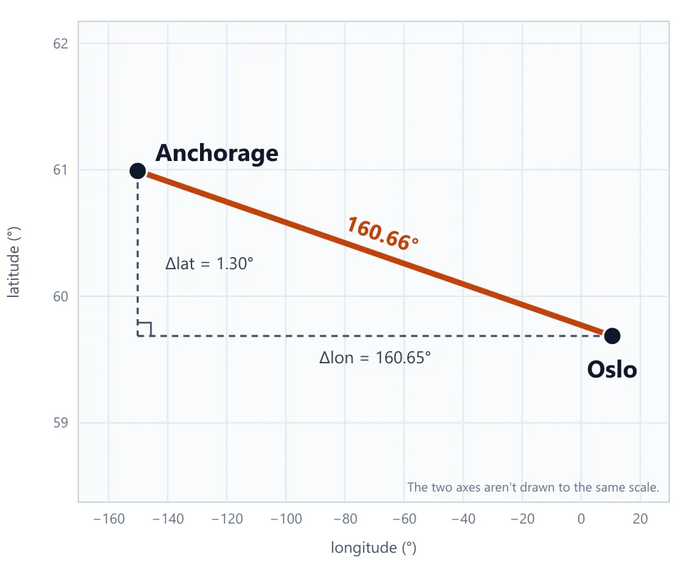
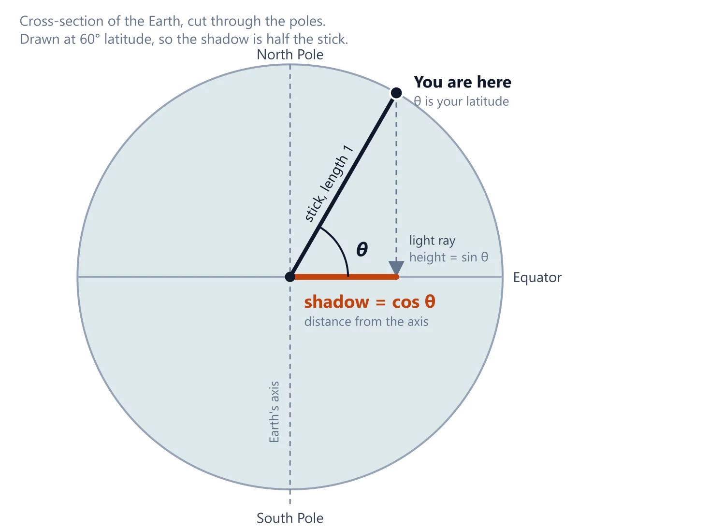

I forgot most of the sin, cos and tan my high school teachers taught me.

[Places to Go](https://github.com/rayhannr/places-to-go), a side project of mine, has a haversine function in it. I wanted to understand how it works, so this post is me working it out.

If you've forgotten trigonometry too, that's fine. Most of the formula comes down to one idea about longitude.

## What haversine answers

You give it two points, each a latitude and a longitude. It gives you the straight-line distance between them over the surface of the Earth, not roads or travel time.

The obvious first try is Pythagoras. Square the difference in latitude and the difference in longitude, add them, take the square root. That works on a flat sheet of paper.

$$
d = \sqrt{(\Delta\text{lat})^2 + (\Delta\text{lon})^2}
$$

Here it is on Oslo and Anchorage, treating a degree of longitude as the same size as a degree of latitude.



The result is 160.66°, which is about 17,833 km at 111 km per degree. The real distance is about 6,444 km, so it comes out nearly three times too long.

It fails because the Earth is round. A degree of latitude is always about the same distance, but a degree of longitude is not.

## A degree of longitude gets shorter as you go north

Picture a globe with the grid lines drawn on it. Lines of latitude are the horizontal rings. Lines of longitude are the vertical ones, running from the North Pole down to the South Pole.

Stand on the equator and walk east until you cross from one longitude line to the next, 1° over. That's about 111 km.

Now follow those same two longitude lines north. They lean toward each other, because every one of them has to end at the pole. Walk east from one to the other in Oslo and it's only about 55 km. Near the pole it's almost nothing.

Same 1° of longitude, less ground. Latitude doesn't do this, because the rings are parallel and 1° north or south is about 111 km wherever you are.

So to turn degrees of longitude into kilometres, we need to know how much to shrink 111 km at a given latitude. Cosine gives us that number.

## Cos with a stick and a shadow

Draw a circle with radius 1 and put a stick from the center to the edge. Start with the stick lying flat on the ground, then tilt it up by some angle.

Now shine a light from straight above. The shadow the stick casts on the ground is the cosine of the angle. The height of its tip above the ground is the sine.

Lying flat (0°), the shadow is the full length of the stick, so cos(0°) = 1. Tilted up to 60°, the shadow is half as long, so cos(60°) = 0.5. Pointing straight up (90°), there's no shadow at all, so cos(90°) = 0.

Now apply it to the Earth. Cut the globe in half through the poles. The stick runs from the center to a point at your latitude, and the tilt of the stick is that latitude.



The shadow is how far you are from the Earth's axis, which is the radius of the east-west circle you'd walk along at your latitude. At latitude θ, that circle is cos(θ) times as big as the one at the equator.

## What cos(lat) means in km

Treat the Earth as a sphere with the 6371 km radius used in the code below, and its circumference is about 40,030 km. Divide by 360 and 1° of longitude at the equator is about 111.2 km. At any other latitude, multiply that by cos(lat).

| Place | Latitude | cos(lat) | 1° of longitude |
| --- | --- | --- | --- |
| Equator | 0° | 1 | 111.2 km |
| Tokyo | 36°N | 0.809 | about 90 km |
| Oslo | 60°N | 0.5 | about 55.6 km |
| Near the North Pole | 89°N | 0.017 | about 1.9 km |

## Radians

The code is full of `* (Math.PI / 180)`. That converts degrees to radians.

A radian is the angle you sweep out by walking along a circle's edge for a distance equal to its radius, about 57.3°. A full circle is 360° and also 2π radians. Divide both by 2 and 180° is π radians, so 1° is π/180 radians. That's why the conversion is degrees × π/180.

`Math.sin` and `Math.cos` only take radians, which is why it's everywhere in the code.

## The formula

A rough version treats the ground as flat and corrects only the longitude side:

```
north_south_km = dLat * 111
east_west_km   = dLon * 111 * cos(lat)
distance       = sqrt(north_south_km² + east_west_km²)
```

That's Pythagoras with the shrinking fixed on the east-west side. It's decent for short distances. Haversine stays correct over long ones, since it works with angles on a sphere instead of pretending the ground is flat.

The real function:

```ts
export function haversineDistance(lat1: number, lon1: number, lat2: number, lon2: number): number {
  const R = 6371 // Radius of the earth in km
  const dLat = (lat2 - lat1) * (Math.PI / 180)
  const dLon = (lon2 - lon1) * (Math.PI / 180)
  const a =
    Math.sin(dLat / 2) * Math.sin(dLat / 2) +
    Math.cos(lat1 * (Math.PI / 180)) * Math.cos(lat2 * (Math.PI / 180)) * Math.sin(dLon / 2) * Math.sin(dLon / 2)
  const c = 2 * Math.atan2(Math.sqrt(a), Math.sqrt(1 - a))
  return R * c
}
```

The variable `a` has two terms added together.

The first one, `sin²(dLat / 2)`, is the north-south part. It needs no correction because 1° of latitude is the same everywhere.

The second one, `cos(lat1) * cos(lat2) * sin²(dLon / 2)`, is the east-west part. It's scaled by cos because longitude lines converge, and it uses both latitudes because the two points can sit at different latitudes.

That `sin²(x / 2)` is the haversine function, hav(x), which gives the formula its name. It's short for "half versed sine", where the versed sine is 1 − cos x. So hav(x) = (1 − cos x) / 2.

The two forms are equal because of a cosine identity, cos x = 1 − 2 sin²(x / 2). Move the terms around and you get sin²(x / 2) = (1 − cos x) / 2.

The sin² form is the one the code uses. For a small angle, cos x is almost exactly 1, so 1 − cos x subtracts two nearly identical numbers and loses precision. sin²(x / 2) gives the same value without that subtraction, which keeps short distances accurate.

`a` isn't a distance yet. It's the sin² of half the angle between the two points as seen from the center of the Earth. `atan2` recovers that half angle and the `2 *` doubles it, giving `c`, the full angle.

The distance is then `R * c`, angle in radians times radius, which is the length of the arc.

## Oslo to Anchorage

Here's the full formula, run on two real cities. Oslo is at 59.9139, 10.7522 and Anchorage is at 61.2181, -149.9003, both rough city-center coordinates.

$$
\begin{aligned}
a &= \sin^2\!\left(\frac{\Delta\text{lat}}{2}\right) + \cos(\text{lat}_1) \cdot \cos(\text{lat}_2) \cdot \sin^2\!\left(\frac{\Delta\text{lon}}{2}\right) \\
c &= 2 \cdot \operatorname{atan2}\!\left(\sqrt{a},\ \sqrt{1-a}\right) \\
d &= R \cdot c
\end{aligned}
$$

Now with the numbers. First the differences, converted to radians:

```
Δlat = 61.2181 − 59.9139    =    1.3042° =  0.022763 rad
Δlon = −149.9003 − 10.7522  = −160.6525° = −2.803915 rad
```

Then the two terms of `a`:

```
north-south = sin²(0.022763 / 2)                    = 0.00013
east-west   = cos(59.9139°) · cos(61.2181°) · sin²(−2.803915 / 2)
            = 0.5013 · 0.4815 · 0.9718              = 0.23455
```

And the rest:

```
a = 0.00013 + 0.23455 = 0.23468
c = 2 · atan2(√0.23468, √(1 − 0.23468)) = 2 · atan2(0.4844, 0.8748) = 1.0114 rad
d = 6371 · 1.0114 = 6,444 km
```

`c` is the angle between the two cities as seen from the center of the Earth. Multiplying it by the radius gives the length of the arc along the surface, which is `d`.


The rough flat version from earlier, with cos taken at the average latitude of the two cities, gives about 8,764 km. That's 36% too long.

The shortest path curves north toward the pole, where longitude lines are closer together, and a straight line on a flat map doesn't follow that curve.

That's why haversine exists.

## The 6371

`R = 6371` is the Earth's mean radius in km, which is about 3959 miles.

The Earth bulges at the equator, with a radius of about 6378 km, and it's flatter at the poles, about 6357 km. Using one number for the whole planet means the result can be off by up to about 0.5%. For most uses that's fine.
