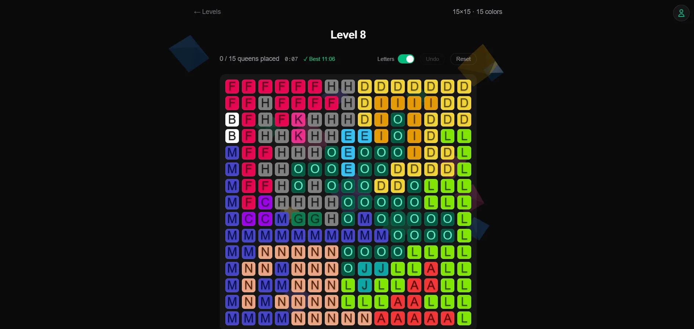

## Background

I started playing LinkedIn's puzzle games earlier this year, mostly because my mutuals' scores kept showing up in my notifications. I ignored them for a while. Then one day I opened the notification and played.

Two of the games were new to me, Queens and Tango. Even with hints, both took me a long time to finish.

In Queens, you place one queen per row, column, and color region, and no two queens may touch, even diagonally.

I kept playing them daily until I understood the pattern. Once I did, I found them fun, and once I had fun, I wanted more. That only happened with Queens though. Tango never clicked for me the same way.

But the problem is that you can only play one game a day. If you want more, you wait until tomorrow.

So I googled Queens and found an [open source version](https://queensgame.vercel.app/community-levels) where anyone can contribute levels. I played it and enjoyed it. It has hundreds of levels, but I finished all of them, and new ones didn't come out every day. So instead of waiting, I decided to build my own.

I didn't fork [samimsu/queens-game](https://github.com/samimsu/queens-game). I just used it as inspiration, mostly for its level builder, where users build a level and submit it to the community. The builder validates every submission. I wanted to see how, so I could decide how my own level generator should work.

## Generating levels

The generator picks a random grid size from 5 to 18. Most levels land between 8 and 11, and the 15 to 18 sizes are rare. The number of colors always equals the grid size.

It places that many queens at random so none of them touch, then grows a colored region around each one. Since the regions grow around a valid set of queens, every board has at least one solution by construction.

One solution isn't enough, though. Most random layouts can only be finished by guessing, and I wanted levels you can solve by deduction. So the generator keeps moving single cells from one region to a neighbor, and keeps a move only if the board doesn't get harder to solve by logic. It stops when a solver that plays like a person, with no guessing, can finish the whole board. That also proves the level has exactly one solution.

About one in ten daily levels skips that check on purpose, so some levels have more than one solution. That's what the Unique and Multiple filter in the level select is for.

Difficulty isn't tied to the level number either. Each level gets a fresh random size, so Level 4 can be 16x16 and Level 5 can be 10x10.

A GitHub Actions workflow runs at 09:00 UTC every day, generates a level, and commits it to the repo. When I've played everything, I run the same script by hand to generate a few dozen more.

In the level select screen, finished levels get a checkmark and show your best time. You can filter by completed or not completed, and by Unique or Multiple solutions.

Inside a level, tapping a tile cycles it from empty to a blocker mark to a queen. There's a timer, Undo and Reset buttons, and a Letters toggle that puts a letter on each tile.

## The stack

The game is a Next.js app with TypeScript and Tailwind, hosted on Vercel. React Query handles the AccelByte calls, and [Three.js](https://threejs.org/) draws the ambient background and the confetti when you win.

Levels are plain TypeScript files in the repo, so there's no database for them. AccelByte only stores player data.

## Syncing progress across devices

At first the game only worked properly on one device. I could open it anywhere, but progress didn't carry over. Playing 100 levels on my phone meant nothing on my laptop.

AccelByte Gaming Services (AGS) fixed that without much work. I used its device ID login, Google login, and Cloud Save, the same services behind [TypeSoFast!](./type-so-fast)

AGS is free for up to 30 concurrent users. I don't expect this game to get anywhere near that, so it should stay free. If you want to build something similar, you can [sign up for AGS](https://prod.gamingservices.accelbyte.io/auth/register).

When someone opens the game, the browser checks local storage for a device ID. If there isn't one, it creates one and logs in with it automatically. AGS creates an account linked to that ID on the first login, and later logins go to the same account. The game logs in again on every load and never stores a token, so a reload never changes who you are.

Finishing a level saves the result to Cloud Save as a player record. The record is a map from level ID to your best time in milliseconds, and a new time only replaces the old one if it's faster. If AGS can't be reached, the game keeps working on progress in local storage and merges it into the record the next time it connects.

The problem is that the device ID lives in local storage. If a player clears their browser data, the progress is still in AGS, but they can't reach it without the exact device ID. Without Google, the data also isn't shared across devices.

That's where Google login comes in. The user icon in the top right is where it happens. If the Google account is new to the game, it gets linked to the current account and nothing else changes. If it already belongs to an account with progress from another device, the browser switches to that account and merges its own progress into it, keeping the faster time for each level. Either way, the player gets the same progress on any device after signing in with that Google account.

Signing out starts a fresh guest account. It never unlinks Google, because that would strand the progress where Google can no longer reach it.

## Where it stands

The game is live at [queens.rayhannr.dev](https://queens.rayhannr.dev) with 470 levels at the time of writing, and a new one every day.

I play it whenever I feel like it. I don't think a week has gone by without me playing at least once.

## Known limitations

The stored device ID works as a permanent login for its account. Anyone who copies it from local storage can open that account without Google. I'm fine with that for a puzzle game.

Guest accounts that get abandoned, after a Google switch or a sign out, stay in AGS.
